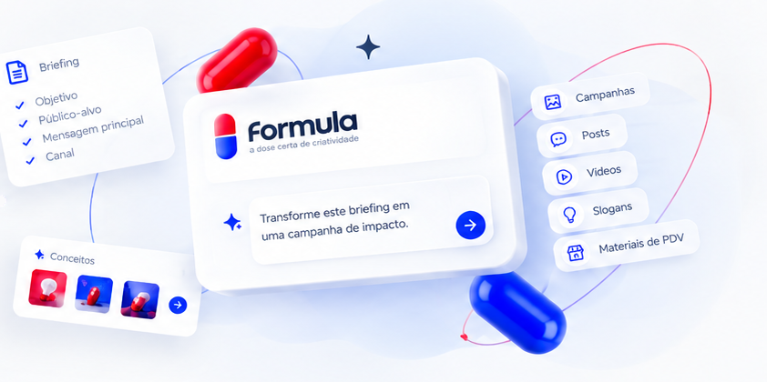
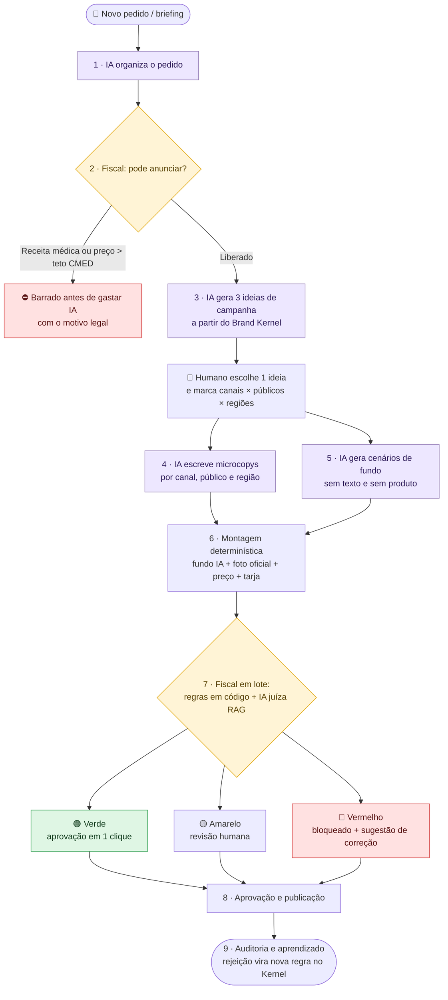

<div align="center">


# Formula

**Compilador criativo com governança de IA para o varejo farmacêutico.**

A IA cria o conceito da campanha, o sistema monta as peças a partir do catálogo oficial
e um fiscal automático só libera o que respeita a Anvisa, o preço máximo e a marca.

<br />



<br />


<br />

<a href="https://formulaprojeto.netlify.app/"></a>

</div>

> [!IMPORTANT]
> **Conformidade e Dados Sintéticos:** Este projeto foi desenvolvido para o desafio *Creative AI (Varejo Farmacêutico)* utilizando exclusivamente bases de dados públicas oficiais (Anvisa, CMED, CONAR, IBGE) e ativos sintéticos, sem exposição de dados proprietários ou confidenciais.

<details>
<summary><b>Sumário</b></summary>

- [Protótipo](#protótipo)
- [O problema](#o-problema)
- [Nossa tese](#nossa-tese)
- [Como funciona](#como-funciona)
- [Tecnologias](#tecnologias)
- [Dados e integração futura](#dados-e-integração-futura)
- [Impacto estimado](#impacto-estimado)
- [Como rodar](#como-rodar)
- [Estrutura do projeto](#estrutura-do-projeto)
- [Squad](#squad)

</details>

---

## Protótipo

> [!NOTE]
> O projeto está na fase de **protótipo navegável**: as telas usam dados de exemplo e o back-end ainda não foi desenvolvido.

🔗 **Acesse:** [formulaprojeto.netlify.app](https://formulaprojeto.netlify.app/)

## O problema

A demanda por criativos no varejo farmacêutico cresce em todas as direções (produtos × canais × formatos × públicos × regiões), mas a equipe de criação continua do mesmo tamanho.

E o gargalo real **não é criar a imagem, é aprovar a peça com segurança jurídica e sanitária**. Toda peça precisa respeitar:

| | Regra | O que exige |
|:-:|---|---|
| 🏥 | **Lei 9.294/1996** e **RDC 96/2008 (Anvisa)** | Sem promessa de cura, sem anúncio de medicamento com receita, advertência obrigatória em MIPs |
| 💲 | **Tabela CMED** | Preço nunca acima do Preço Máximo ao Consumidor (PMC) |
| ⚖️ | **CONAR (Anexo I)** e **CDC** | Autorregulamentação publicitária e direitos do consumidor |
| 🎨 | **Manual da marca** | Embalagem oficial intacta, paleta, tipografia e tom de voz |

## Nossa tese

> **"Não geramos peças soltas. Geramos um conceito e compilamos peças."**

A maioria das soluções usa IA como gerador de imagem (entra briefing, sai imagem). Isso multiplica o custo de API, deforma rótulo de remédio e não resolve a governança. O Formula funciona como um **compilador**:

| Peça | Papel |
|---|---|
| 🧬 **Brand Kernel** | Leis e tokens visuais viram registros versionados em JSON (ID, fonte legal, vigência). Nada escondido dentro de prompt. |
| 💡 **Concept Compiler** | A IA generativa cria o conceito central e os cenários de fundo, sem texto. |
| 🥪 **Técnica do Sanduíche** | Foto oficial (PNG), preço, selo promocional e tarja da Anvisa vêm do catálogo e entram por template determinístico em cada canal, público e região. |
| 🚦 **Compliance Gate** | Fiscal híbrido (regras em código + IA juíza com RAG) classifica cada peça em verde, amarelo ou vermelho e aprende com cada revisão humana. |

## Como funciona

O fluxo tem 9 etapas e dois pontos de checagem: um **antes** de gastar IA e outro **depois** de montar as peças.



## Tecnologias

- **Interface:** React 18 com React Router para a navegação entre as telas.
- **Build e servidor de desenvolvimento:** Vite.
- **Linguagens:** JavaScript (JSX), CSS próprio e HTML.
- **Hospedagem do protótipo:** Netlify.
- **Próximo passo:** Next.js, previsto para a evolução do projeto.

## Dados e integração futura

Nenhum dado interno do cliente é usado. A proposta é que o sistema leia `.json` montados a partir de bases públicas, e que cada arquivo possa ser trocado pela API real da empresa sem reconstruir o sistema.

| Arquivo | Base pública de referência | Função prevista | Na empresa real |
|---|---|---|---|
| `produtos.json` | Dados Abertos Anvisa, Tabela CMED, Open Beauty Facts | Checa exigência de receita, valida teto de preço, fornece foto oficial e resumo da bula | API do ERP / catálogo do e-commerce |
| `regras.json` | Lei 9.294/96, RDC 96/2008, CONAR, CDC | Alimenta o RAG do fiscal e as travas em código | Base de regras do Jurídico / Compliance |
| `marca.json` | Manual sintético + Google Fonts | Orienta títulos, cores permitidas e palavras proibidas | Manual oficial e DAM da marca |
| `canais.json` `publicos.json` `regioes.json` | IBGE, Google Trends, formatos digitais | Limite de caracteres por formato e adaptação por região e faixa etária | CRM e histórico de campanhas |

## Impacto estimado

A métrica central não é "peças por hora", e sim **minutos de atenção humana por peça aprovada**.

<table>
<tr>
<td align="center" width="33%"><h3>&gt; 90%</h3>menos tempo de produção<br/><sub>30 peças: de ~25–30 h para ~4 min</sub></td>
<td align="center" width="33%"><h3>0,4 min</h3>de atenção humana por peça<br/><sub>antes: 15–20 min de revisão manual</sub></td>
<td align="center" width="33%"><h3>0</h3>peças irregulares publicadas<br/><sub>bloqueio na 1ª e na 2ª checagem</sub></td>
</tr>
</table>

<sub>Cenário de referência: 30 peças = 3 públicos × 5 canais × 2 versões.</sub>

## Como rodar

**Pré-requisito:** [Node.js](https://nodejs.org/) 18 ou mais recente.

**1. Clonar e entrar no front**

```bash
git clone https://github.com/MarcusDevHub/formula-creative.git
cd formula-creative/front
```

**2. Instalar e rodar**

```bash
npm install
npm run dev
```

Abra o endereço que aparecer no terminal (normalmente `http://localhost:5173`).

> [!TIP]
> O protótipo roda com **dados de exemplo** e aceita qualquer e-mail e senha no login.

## Estrutura do projeto

```
formula-creative/
└── front/
    └── src/
        ├── api/            ← dados de exemplo usados pelas telas
        ├── assets/         ← logo e imagens
        ├── components/     ← layout, stepper, preview de peça, badges
        ├── pages/          ← landing, login, dashboard, campanha, ideias,
        │                     estúdio, peças, aprovações, regras da marca
        └── styles/         ← global, landing e dashboard
```

## Squad

| Foto | Nome | Função | GitHub | Email |
|:-:|---|---|---|---|
|  | Marcus Thulio | Back-end | [MarcusDevHub](https://github.com/MarcusDevHub) | <!-- email --> |
|  | Laura Brayner | Front-end e design | [laurabrayner](https://github.com/laurabrayner) | [lcbc@cesar.school](mailto:lcbc@cesar.school) |
| | Virginia Fonseca | Organização das tarefas (Trello) | | [virginiaxfernandes@gmail.com](mailto:virginiaxfernandes@gmail.com) |
| | Yan Ferreira | <!-- função --> | | [yanferreira985@gmail.com](mailto:yanferreira985@gmail.com) |

<div align="center">
<br />
<sub>Feito para o desafio <b>Creative AI</b> · Hackathon </sub>
</div>
